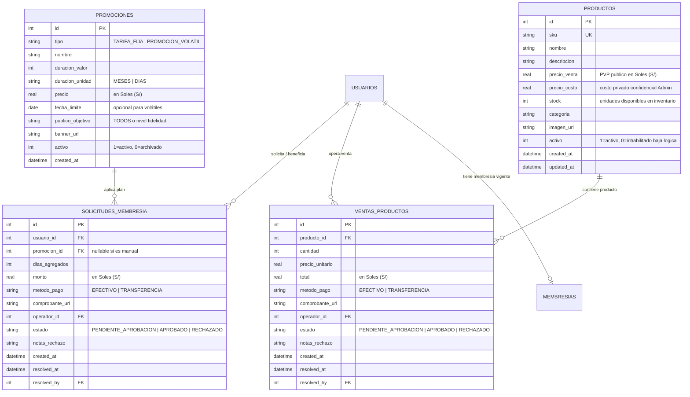
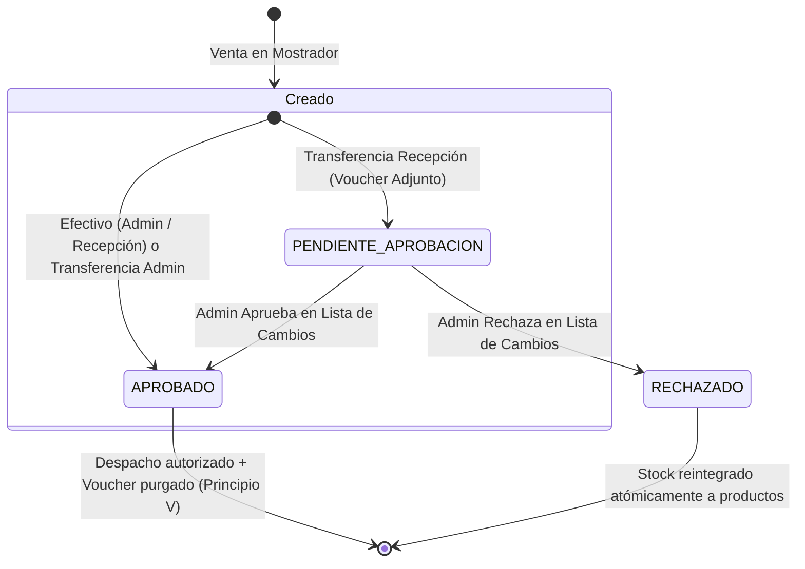
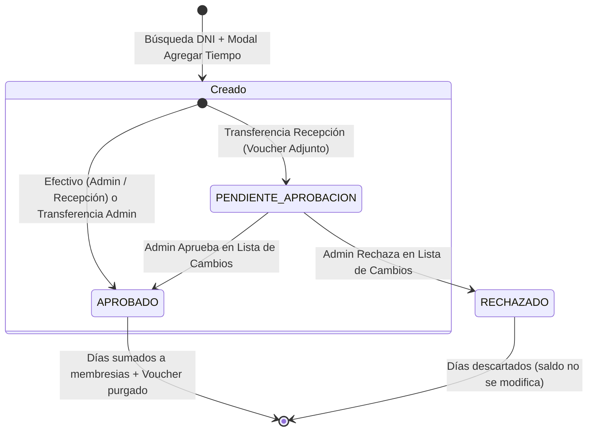

# Data Model: 002 - Membresías, Promociones y Productos

**Branch**: `002-membresias-y-productos`  
**Date**: 2026-10-25  
**Spec**: [spec.md](./spec.md)

---

## 1. Esquema Relacional de Entidades



---

## 2. Definición Detallada de Tablas (DDL SQLite)

### 2.1 Tabla: `promociones`
Almacena el catálogo de planes de membresía fijos y ofertas volátiles diseñadas por el Administrador.

```sql
CREATE TABLE IF NOT EXISTS promociones (
    id INTEGER PRIMARY KEY AUTOINCREMENT,
    tipo TEXT NOT NULL CHECK(tipo IN ('TARIFA_FIJA', 'PROMOCION_VOLATIL')) DEFAULT 'TARIFA_FIJA',
    nombre TEXT NOT NULL,
    duracion_valor INTEGER NOT NULL CHECK(duracion_valor > 0),
    duracion_unidad TEXT NOT NULL CHECK(duracion_unidad IN ('MESES', 'DIAS')),
    precio REAL NOT NULL CHECK(precio >= 0),
    fecha_limite DATE,
    publico_objetivo TEXT NOT NULL DEFAULT 'TODOS' CHECK(publico_objetivo IN (
        'TODOS', 'NOVATO', 'PRINCIPIANTE', 'PROMEDIO', 'EN_PROGRESO', 
        'MUTANDO', 'MAMADO', 'DIOS_GRIEGO', 'ANIMAL'
    )),
    banner_url TEXT,
    activo INTEGER NOT NULL DEFAULT 1 CHECK(activo IN (0, 1)),
    created_at DATETIME NOT NULL DEFAULT CURRENT_TIMESTAMP
);

CREATE INDEX IF NOT EXISTS idx_promociones_activo ON promociones(activo);
CREATE INDEX IF NOT EXISTS idx_promociones_publico ON promociones(publico_objetivo);
```

### 2.2 Tabla: `productos`
Gestiona el inventario físico de suplementos, bebidas y accesorios. Incorpora baja lógica (`activo = 0`) para preservar el historial de ventas previas.

```sql
CREATE TABLE IF NOT EXISTS productos (
    id INTEGER PRIMARY KEY AUTOINCREMENT,
    sku TEXT UNIQUE,
    nombre TEXT NOT NULL,
    descripcion TEXT,
    precio_venta REAL NOT NULL CHECK(precio_venta >= 0),
    precio_costo REAL NOT NULL CHECK(precio_costo >= 0),
    stock INTEGER NOT NULL DEFAULT 0 CHECK(stock >= 0),
    categoria TEXT NOT NULL DEFAULT 'GENERAL',
    imagen_url TEXT,
    activo INTEGER NOT NULL DEFAULT 1 CHECK(activo IN (0, 1)),
    created_at DATETIME NOT NULL DEFAULT CURRENT_TIMESTAMP,
    updated_at DATETIME NOT NULL DEFAULT CURRENT_TIMESTAMP
);

CREATE INDEX IF NOT EXISTS idx_productos_activo ON productos(activo);
CREATE INDEX IF NOT EXISTS idx_productos_stock ON productos(stock);
CREATE INDEX IF NOT EXISTS idx_productos_categoria ON productos(categoria);
```

### 2.3 Tabla: `ventas_productos`
Registra las transacciones del terminal POS en mostrador. Incluye el estado de aprobación y soporte para reserva preventiva de existencias.

```sql
CREATE TABLE IF NOT EXISTS ventas_productos (
    id INTEGER PRIMARY KEY AUTOINCREMENT,
    producto_id INTEGER NOT NULL,
    cantidad INTEGER NOT NULL CHECK(cantidad > 0),
    precio_unitario REAL NOT NULL CHECK(precio_unitario >= 0),
    total REAL NOT NULL CHECK(total >= 0),
    metodo_pago TEXT NOT NULL CHECK(metodo_pago IN ('EFECTIVO', 'TRANSFERENCIA')),
    comprobante_url TEXT,
    operador_id INTEGER NOT NULL,
    estado TEXT NOT NULL CHECK(estado IN ('PENDIENTE_APROBACION', 'APROBADO', 'RECHAZADO')),
    notas_rechazo TEXT,
    created_at DATETIME NOT NULL DEFAULT CURRENT_TIMESTAMP,
    resolved_at DATETIME,
    resolved_by INTEGER,
    FOREIGN KEY (producto_id) REFERENCES productos(id),
    FOREIGN KEY (operador_id) REFERENCES usuarios(id),
    FOREIGN KEY (resolved_by) REFERENCES usuarios(id)
);

CREATE INDEX IF NOT EXISTS idx_ventas_estado ON ventas_productos(estado);
CREATE INDEX IF NOT EXISTS idx_ventas_producto ON ventas_productos(producto_id);
CREATE INDEX IF NOT EXISTS idx_ventas_created ON ventas_productos(created_at DESC);
```

### 2.4 Tabla: `solicitudes_membresia`
Registra las operaciones de extensión o adición de tiempo a las cuentas de los atletas, gestionando la conciliación de comprobantes.

```sql
CREATE TABLE IF NOT EXISTS solicitudes_membresia (
    id INTEGER PRIMARY KEY AUTOINCREMENT,
    usuario_id INTEGER NOT NULL,
    promocion_id INTEGER,
    dias_agregados INTEGER NOT NULL CHECK(dias_agregados > 0),
    monto REAL NOT NULL CHECK(monto >= 0),
    metodo_pago TEXT NOT NULL CHECK(metodo_pago IN ('EFECTIVO', 'TRANSFERENCIA')),
    comprobante_url TEXT,
    operador_id INTEGER NOT NULL,
    estado TEXT NOT NULL CHECK(estado IN ('PENDIENTE_APROBACION', 'APROBADO', 'RECHAZADO')),
    notas_rechazo TEXT,
    created_at DATETIME NOT NULL DEFAULT CURRENT_TIMESTAMP,
    resolved_at DATETIME,
    resolved_by INTEGER,
    FOREIGN KEY (usuario_id) REFERENCES usuarios(id) ON DELETE CASCADE,
    FOREIGN KEY (promocion_id) REFERENCES promociones(id) ON DELETE SET NULL,
    FOREIGN KEY (operador_id) REFERENCES usuarios(id),
    FOREIGN KEY (resolved_by) REFERENCES usuarios(id)
);

CREATE INDEX IF NOT EXISTS idx_solicitudes_estado ON solicitudes_membresia(estado);
CREATE INDEX IF NOT EXISTS idx_solicitudes_usuario ON solicitudes_membresia(usuario_id);
CREATE INDEX IF NOT EXISTS idx_solicitudes_created ON solicitudes_membresia(created_at DESC);
```

---

## 3. Reglas de Validación y Transición de Estados

### 3.1 Transiciones en Venta de Productos (`ventas_productos`)



- **Al crear con Efectivo**: El stock de `productos` disminuye de inmediato (`stock = stock - cantidad`). `estado = 'APROBADO'`. Despacho instantáneo.
- **Al crear con Transferencia (Recepción)**: Se verifica `stock >= cantidad`. El stock de `productos` se descuenta preventivamente para evitar sobreventa. `estado = 'PENDIENTE_APROBACION'`. Despacho bloqueado en espera de verificación bancaria.
- **Al Aprobar (Admin)**: `estado = 'APROBADO'`, `resolved_at = CURRENT_TIMESTAMP`, `resolved_by = admin_id`. Se elimina el archivo de imagen de disco (`uploads/vouchers/`) y se marca `comprobante_url = 'PURGADO_TRAS_APROBACION'`. Despacho liberado.
- **Al Rechazar (Admin)**: `estado = 'RECHAZADO'`, `resolved_at = CURRENT_TIMESTAMP`, `resolved_by = admin_id`. Se revierte el descuento: `stock = stock + cantidad`. Despacho cancelado definitivamente.

### 3.2 Transiciones en Extensión de Membresías (`solicitudes_membresia`)



- **Cálculo de Vigencia**:
  - Si el atleta tiene una membresía con fecha de vencimiento posterior a hoy (`fecha_vencimiento >= fecha_actual`), la nueva fecha de vencimiento es: `fecha_vencimiento + dias_agregados`.
  - Si el atleta tiene su membresía vencida (`fecha_vencimiento < fecha_actual`), la nueva fecha de vencimiento es: `fecha_actual + dias_agregados`.
- **Efectivo / Admin**: Aplica el cálculo y actualiza inmediatamente la tabla `membresias`. `estado = 'APROBADO'`.
- **Transferencia Recepción**: Registra la solicitud en `solicitudes_membresia` con `estado = 'PENDIENTE_APROBACION'`. La tabla `membresias` **no se modifica** hasta que el Administrador apruebe la solicitud en la pantalla de Cambios & Aprobaciones.

---

## 4. Políticas de Visibilidad y Protección de Datos

1. **Precio de Costo (`precio_costo`)**:
   - `ADMINISTRADOR`: Lectura y escritura permitida en todas las pantallas.
   - `RECEPCIONISTA`: El campo no existe en las respuestas JSON devueltas por la API (`undefined`/excluido).
   - `MIEMBRO`: El campo no existe en las respuestas JSON.
2. **Productos con Stock 0 (`stock = 0`)**:
   - `ADMINISTRADOR` y `RECEPCIONISTA`: Se muestran en la grilla con opacidad reducida (60%), sello de agotado y deshabilitados para selección en venta.
   - `MIEMBRO`: Se filtran en el backend (`WHERE stock > 0 AND activo = 1`), siendo completamente invisibles en la tienda de la app móvil.
3. **Baja Lógica (`activo = 0`)**:
   - Al eliminar un producto, `activo` pasa a `0`. Se oculta del catálogo operativo y de la venta, pero las filas existentes en `ventas_productos` preservan el `producto_id`, nombres y montos históricos para auditoría y balance de caja.
