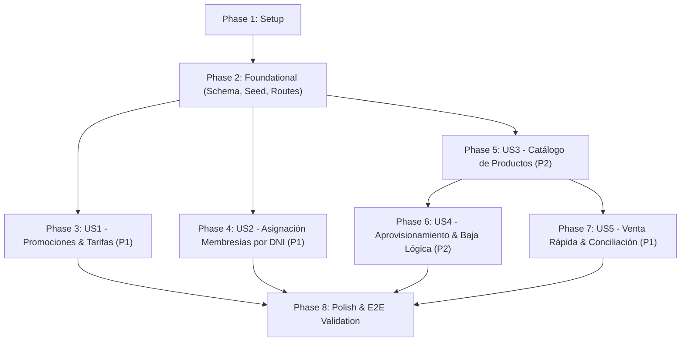

# Tasks: 002 - Membresías, Promociones y Productos

**Input**: Design documents from `/specs/002-membresias-y-productos/`  
**Prerequisites**: [plan.md](./plan.md), [spec.md](./spec.md), [research.md](./research.md), [data-model.md](./data-model.md), [contracts/](./contracts/), [quickstart.md](./quickstart.md)

**Tests**: Incluye pruebas unitarias y de integración para validar la confidencialidad de costos, reserva preventiva de existencias, cálculo de vigencias y purgado de comprobantes (Principio V) requeridos por la especificación y `AGENTS.md`.

**Organization**: Las tareas están agrupadas por fases y por cada Historia de Usuario (HU1 a HU5) para permitir implementación independiente, pruebas atómicas y despliegue modular.

---

## Format: `[ID] [P?] [Story?] Description`

- **[P]**: Tarea paralelizable (archivos distintos, sin dependencias bloqueantes).
- **[Story]**: Historia de usuario a la que pertenece (`[US1]`, `[US2]`, `[US3]`, `[US4]`, `[US5]`).
- Cada tarea define una acción clara y contiene rutas de archivos concretas.

---

## Phase 1: Setup (Shared Infrastructure)

**Purpose**: Inicialización del almacenamiento de archivos para comprobantes y banners, y configuración del entorno de pruebas.

- [ ] T001 Crear directorios para uploads (`uploads/banners/`, `uploads/productos/`, `uploads/vouchers/`) y configurar destinos de multer en `server/utils/upload.js`
- [ ] T002 [P] Configurar el entorno de pruebas en `package.json` para ejecutar suites de integración y unitarias de la feature 002

---

## Phase 2: Foundational (Blocking Prerequisites)

**Purpose**: Infraestructura central de base de datos, servicio de conciliación y enrutamiento base que DEBE completarse antes de las historias de usuario.

> **CRITICAL**: No puede comenzar la implementación de historias de usuario hasta completar esta fase.

- [ ] T003 Actualizar el esquema DDL SQLite en `server/schema.sql` agregando las tablas `promociones`, `productos`, `ventas_productos` y `solicitudes_membresia` con checks de tipos, restricciones de moneda (`S/`), DNI y claves foráneas habilitadas (`PRAGMA foreign_keys = ON;`)
- [ ] T004 Actualizar el script de datos iniciales en `server/seed.js` sembrando promociones activas, productos con stock positivo y stock 0, y atletas de prueba para las ventas y extensiones
- [ ] T005 [P] Implementar servicio de auditoría y conciliación base en `server/services/aprobacionService.js` con método para purgar físicamente imágenes de comprobantes usando `fs.promises.unlink()` conforme al Principio Constitucional V
- [ ] T006 Montar y registrar las nuevas rutas en `server/server.js` (`/api/promociones`, `/api/productos`, `/api/membresias`, `/api/aprobaciones`)
- [ ] T007 [P] Actualizar navegación y badges de rutas en `src/components/common/Sidebar.jsx` y `src/App.jsx` agregando enlaces para `/admin/membresias-promociones`, `/admin/productos`, `/admin/aprobaciones`, `/recepcion/membresias` y `/recepcion/productos`

**Checkpoint**: Base relacional y ruteo listos. La implementación de historias de usuario puede comenzar.

---

## Phase 3: User Story 1 - Gestión de Promociones y Precios Maestros (Priority: P1)

**Goal**: Permitir al Administrador crear tarifas fijas y promociones volátiles (con duración, precio en `S/`, banner publicitario 16:9 y filtro de fidelidad) y consultar el catálogo activo.

**Independent Test**: Acceder a "Forja de Planes y Tarifas" en `/admin/membresias-promociones`, registrar una promoción con banner y validar que aparezca en el catálogo activo con su vigencia y precio en `S/`.

### Pruebas para User Story 1
- [ ] T008 [P] [US1] Prueba unitaria de filtrado de promociones según nivel de fidelidad del usuario en `tests/unit/promoFiltering.test.js`
- [ ] T009 [P] [US1] Prueba de integración para endpoints de promociones (`GET /api/promociones`, `POST /api/promociones`, `PATCH /api/promociones/:id/archivar`) en `tests/integration/promocionesApi.test.js`

### Implementación para User Story 1
- [ ] T010 [US1] Implementar servicio de promociones en `server/services/promocionService.js` validando `tipo IN ('TARIFA_FIJA', 'PROMOCION_VOLATIL')`, `duracion_valor > 0`, `duracion_unidad IN ('MESES', 'DIAS')`, `precio >= 0` y `publico_objetivo`
- [ ] T011 [US1] Implementar controlador y rutas en `server/routes/promociones.js` con middleware de subida de banner y verificación de rol exclusivo `ADMINISTRADOR`
- [ ] T012 [P] [US1] Implementar componente de formulario "Forja de Planes y Tarifas" con subida de imagen y preview 16:9 en `src/components/admin/PromoForm.jsx` replicando el diseño de `stitch-referencias/002-membresias-y-productos/admin_gesti_n_de_membres_as_y_promociones_1/code.html`
- [ ] T013 [P] [US1] Implementar grilla de tarjetas "Promociones y Precios Activos" con badges de vigencia, precio en `S/` y botón para archivar en `src/components/admin/PromoGrid.jsx`
- [ ] T014 [US1] Ensamblar la vista principal de promociones del Administrador en `src/pages/admin/MembershipPromos.jsx` integrando `PromoForm` y `PromoGrid`

**Checkpoint**: User Story 1 completada y verificable de forma independiente.

---

## Phase 4: User Story 2 - Asignación y Extensión de Membresías por DNI (Priority: P1)

**Goal**: Permitir a Recepción y Admin buscar a un atleta por su DNI de 8 dígitos y abrir una ventana emergente para asignarle tiempo (eligiendo una promoción o meses/días manuales) con pago en Efectivo (inmediato) o Transferencia (con comprobante digital).

**Independent Test**: Buscar el DNI `72849102`, constatar que cargue su ficha con los días restantes, abrir el modal "Agregar tiempo de membresía", seleccionar Efectivo (suma +30 días al instante) o Transferencia (deriva a aprobación).

### Pruebas para User Story 2
- [ ] T015 [P] [US2] Prueba unitaria del cálculo de vigencia para membresías activas vs vencidas en `tests/unit/membershipDuration.test.js`
- [ ] T016 [P] [US2] Prueba de integración para el endpoint de búsqueda por DNI y asignación de tiempo en `tests/integration/membresiasApi.test.js`

### Implementación para User Story 2
- [ ] T017 [US2] Implementar servicio de membresías en `server/services/membresiaService.js` con métodos para búsqueda por DNI de 8 dígitos, cálculo de nueva fecha de caducidad y registro en `solicitudes_membresia`
- [ ] T018 [US2] Implementar controlador y rutas en `server/routes/membresias.js` (`GET /api/membresias/buscar/:dni` y `POST /api/membresias/asignar` con subida obligatoria de voucher para recepcionistas)
- [ ] T019 [P] [US2] Implementar componente de búsqueda por DNI y ficha táctica de atleta en `src/components/reception/MembershipLookup.jsx` siguiendo `stitch-referencias/002-membresias-y-productos/admin_gesti_n_de_membres_as_y_promociones_2/code.html`
- [ ] T020 [P] [US2] Implementar modal emergente "Agregar Tiempo de Membresía" en `src/components/modals/AddTimeModal.jsx` con tabs (Elegir Promoción Activa vs Agregar Meses/Días), radios Efectivo/Transferencia, zona de comprobante y cálculo en vivo
- [ ] T021 [US2] Ensamblar la pantalla de membresías para recepción en `src/pages/reception/MembershipOps.jsx` e incorporar el botón de apertura del modal en `src/pages/admin/MembershipPromos.jsx`

**Checkpoint**: User Stories 1 y 2 funcionando y testables independientemente.

---

## Phase 5: User Story 3 - Catálogo e Inventario de Productos (Priority: P2)

**Goal**: Visualizar la grilla de productos con imagen, PVP en Soles (`S/`), stock numérico, estilo translúcido con sello `AGOTADO // SIN STOCK DISPONIBLE` para stock 0 en mostrador, y confidencialidad absoluta del precio de costo privado ante recepcionistas y atletas.

**Independent Test**: Navegar a la grilla de productos como Admin y verificar que se muestre el costo privado y margen comercial; iniciar como Recepcionista y constatar que el costo esté oculto; verificar que los productos con stock 0 aparezcan translúcidos en mostrador y no se exhiban en la app de atletas.

### Pruebas para User Story 3
- [ ] T022 [P] [US3] Prueba unitaria de confidencialidad de datos (`precio_costo` omitido para recepción/miembro) y filtro de stock en `tests/unit/productPrivacy.test.js`
- [ ] T023 [P] [US3] Prueba de integración para el endpoint de catálogo de productos (`GET /api/productos`) en `tests/integration/productosCatalog.test.js`

### Implementación para User Story 3
- [ ] T024 [US3] Implementar consulta de catálogo con sanitización de privilegios en `server/services/productoService.js` (excluyendo `precio_costo` para recepcionistas y filtrando `stock = 0` para miembros)
- [ ] T025 [US3] Implementar ruta de consulta de catálogo en `server/routes/productos.js` (`GET /api/productos`)
- [ ] T026 [P] [US3] Implementar grilla de tarjetas de productos en `src/components/admin/ProductMasterGrid.jsx` con estilo translúcido (opacidad al 60%) y sello `AGOTADO // SIN STOCK DISPONIBLE` para stock = 0, y telemetría de costos y margen comercial para Admin según `stitch-referencias/002-membresias-y-productos/admin_manejo_de_productos_con_modales_agregar_y_vender/code.html`
- [ ] T027 [US3] Ensamblar la página de Inventario y Stock en `src/pages/admin/ProductInventory.jsx` con chips de filtro de categoría (Todos, Suplementos, Bebidas, Accesorios) y contadores de telemetría (Valor en stock, SKUs activos)

**Checkpoint**: Catálogo de productos operativo y protegido por roles.

---

## Phase 6: User Story 4 - Aprovisionamiento, Edición y Baja Lógica de Productos por Admin (Priority: P2)

**Goal**: Permitir al Administrador registrar nuevos productos mediante el botón flotante azul `[+] AGREGAR PRODUCTOS` (capturando costo privado y stock inicial), editarlos y eliminarlos mediante baja lógica (`activo = 0`) para preservar el histórico de ventas.

**Independent Test**: Abrir el modal azul, registrar un nuevo suplemento con su costo y stock, editar su precio y finalmente darlo de baja lógica, confirmando que desaparece del catálogo activo sin borrar registros pasados.

### Pruebas para User Story 4
- [ ] T028 [P] [US4] Prueba de integración para operaciones CRUD de productos (`POST /api/productos`, `PUT /api/productos/:id`, `DELETE /api/productos/:id`) en `tests/integration/productAdminApi.test.js`

### Implementación para User Story 4
- [ ] T029 [US4] Implementar métodos de inserción, edición y baja lógica (`UPDATE productos SET activo = 0 WHERE id = ?`) en `server/services/productoService.js`
- [ ] T030 [US4] Implementar endpoints de administración de productos en `server/routes/productos.js` (`POST /`, `PUT /:id`, `DELETE /:id`) con procesamiento de imágenes multipart
- [ ] T031 [P] [US4] Implementar modal azul "[+] AGREGAR PRODUCTOS" en `src/components/modals/AddProductModal.jsx` y modal de edición en `src/components/modals/EditProductModal.jsx` con campos para foto, nombre, descripción, PVP en `S/`, costo privado y stock inicial
- [ ] T032 [US4] Integrar la barra flotante de acciones y los modales de alta/edición/baja lógica en `src/pages/admin/ProductInventory.jsx`

**Checkpoint**: Gestión completa del inventario por el Administrador terminada.

---

## Phase 7: User Story 5 - Venta Rápida en Mostrador y Conciliación en Lista de Cambios (Priority: P1)

**Goal**: Permitir a Recepción y Admin vender productos en mostrador mediante el botón verde `[$] VENDER PRODUCTO`, aplicando reserva preventiva de stock en transferencias, retención de entrega y conciliación formal en Cambios & Aprobaciones con purgado físico del voucher (Principio V) y reversión de existencias ante rechazo.

**Independent Test**: Abrir el modal de venta, comprobar que solo liste productos con stock > 0 y acote la cantidad al stock disponible; registrar una venta por transferencia en recepción, verificar que el stock disminuya preventivamente y que la entrega quede bloqueada; entrar como Admin, rechazar la venta y confirmar que el stock se reintegra de inmediato. En una segunda prueba, aprobar una transferencia y constatar que el archivo de imagen se purgue del disco.

### Pruebas para User Story 5
- [ ] T033 [P] [US5] Prueba unitaria de reserva preventiva de stock (`stock = stock - cantidad`), bloqueo de sobreventa (`cantidad <= stock`) y reversión atómica en `tests/unit/stockReservation.test.js`
- [ ] T034 [P] [US5] Prueba de integración para venta rápida (`POST /api/productos/vender`) y conciliación (`POST /api/aprobaciones/:tipo/:id/aprobar`, `POST /api/aprobaciones/:tipo/:id/rechazar`) validando la eliminación del archivo físico de voucher en `tests/integration/salesAndApprovalsApi.test.js`

### Implementación para User Story 5
- [ ] T035 [US5] Implementar lógica de venta rápida en `server/services/productoService.js` con transacción SQLite inmediata para descontar preventivamente existencias y registrar en `ventas_productos`
- [ ] T036 [US5] Implementar lógica de conciliación en `server/services/aprobacionService.js`: al aprobar, purgar permanentemente la imagen en `uploads/vouchers/` con `fs.promises.unlink()` (Principio V) y activar días/despacho; al rechazar, reintegrar el stock reservado (`UPDATE productos SET stock = stock + cantidad`)
- [ ] T037 [US5] Implementar endpoint de venta en `server/routes/productos.js` (`POST /vender`) y endpoints de conciliación en `server/routes/aprobaciones.js` (`GET /`, `POST /:tipo/:id/aprobar`, `POST /:tipo/:id/rechazar`)
- [ ] T038 [P] [US5] Implementar modal verde "[$] VENDER PRODUCTO" en `src/components/modals/SellProductModal.jsx` con desplegable de productos con stock > 0, selector de cantidad con botones +/- acotado al stock máximo, radios de pago con subida obligatoria de voucher para transferencias, y cálculo de total en `S/` en tiempo real
- [ ] T039 [P] [US5] Implementar pantalla de terminal POS de recepción en `src/pages/reception/QuickSales.jsx` con métricas de turno (ventas turno, base caja chica, arqueo TX) y filtro de productos replicando `stitch-referencias/002-membresias-y-productos/recepci_n_venta_r_pida_de_productos_2/code.html`
- [ ] T040 [P] [US5] Implementar componente de lista de aprobaciones en `src/components/admin/ApprovalsList.jsx` y página `src/pages/admin/ApprovalsPage.jsx` para previsualizar vouchers, aprobar con purgado físico y rechazar con reversión de stock

**Checkpoint**: Circuito completo de ventas en mostrador y conciliación con purgado de comprobantes terminado.

---

## Phase 8: Polish & Cross-Cutting Concerns

**Purpose**: Integración de la vista móvil de miembros, pruebas integrales y verificación de extremo a extremo.

- [ ] T041 [P] Actualizar vista móvil de miembros en `src/pages/member/MemberCard.jsx` mostrando promociones vigentes según su nivel de fidelidad y tienda de productos excluyendo artículos con stock = 0
- [ ] T042 Ejecutar suite completa de pruebas con `npm test` verificando que todas las pruebas unitarias y de integración pasen sin errores
- [ ] T043 Ejecutar validación interactiva completa siguiendo todos los escenarios de [quickstart.md](./quickstart.md) en navegador y emulador móvil

---

## Dependencies & Execution Order

### Phase Dependencies

- **Phase 1 (Setup)**: Se ejecuta de inmediato.
- **Phase 2 (Foundational)**: Bloquea todas las historias de usuario. Prepara tablas en SQLite, seeds y servicios de subida y purgado.
- **Phase 3 (US1) & Phase 4 (US2)**: Pueden ejecutarse en paralelo o secuencialmente tras la fase 2.
- **Phase 5 (US3)**: Base visual y funcional para productos; requerida antes de US4 y US5.
- **Phase 6 (US4) & Phase 7 (US5)**: Implementan el ciclo completo de inventario, ventas y conciliación.
- **Phase 8 (Polish)**: Cierra la integración móvil y ejecuta las pruebas de extremo a extremo.

---

## Parallel Opportunities

1. **En Setup**:
   - `T001` (directorios uploads) y `T002` (configuración tests) pueden ejecutarse en paralelo.
2. **En Foundational**:
   - `T005` (servicio de conciliación/purgado) y `T007` (sidebar/rutas UI) pueden desarrollarse en paralelo con el DDL `T003`.
3. **En User Stories**:
   - Pruebas unitarias/integración (`T008`, `T009`, `T015`, `T016`, `T022`, `T023`, `T028`, `T033`, `T034`) marcadas con `[P]` pueden escribirse antes o en paralelo a los componentes UI.
   - Componentes frontend (`T012`, `T013`, `T019`, `T020`, `T026`, `T031`, `T038`, `T039`, `T040`) marcados con `[P]` pueden desarrollarse en paralelo a la lógica de servicios backend (`T010`, `T017`, `T024`, `T029`, `T035`).

---

## Implementation Strategy

### MVP First (Historias P1 Prioritarias)
1. Completar Setup + Foundational (Fases 1 y 2).
2. Implementar **US1** (Promociones maestras) y **US2** (Asignación de membresías por DNI en efectivo).
3. Validar de forma independiente: la recepción ya puede buscar atletas por DNI y cobrar membresías en efectivo de inmediato.

### Incremento Comercial (Inventario y Venta Mostrador)
4. Implementar **US3** (Catálogo de productos con costos privados para Admin) y **US4** (Alta/edición/baja lógica).
5. Implementar **US5** (Venta rápida POS, reserva preventiva y panel de Cambios & Aprobaciones con purgado físico de comprobantes).
6. Ejecutar `npm test` y el recorrido completo de [quickstart.md](./quickstart.md).
