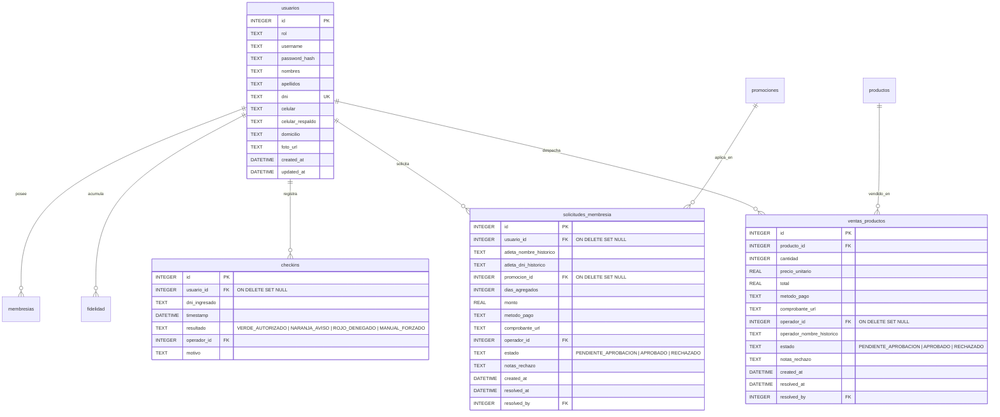

# Data Model: 003 - Auditoría, Reportes PDF y 3 Sitios

**Feature**: `003-auditoria-reportes-y-3-sitios`  
**Date**: 2026-11-12  
**Storage**: SQLite local (`server/gymcore.db`)  

---

## 1. Diagrama Entidad-Relación y Estructura de Datos



---

## 2. Definición Detallada de Entidades y Campos

### 2.1. Tabla `usuarios`
Almacena las cuentas de acceso para los tres portales:
- `id` (INTEGER, PK, Autoincremental).
- `rol` (TEXT, NOT NULL): `'ADMINISTRADOR'`, `'RECEPCIONISTA'`, `'MIEMBRO'`.
- `username` (TEXT, NOT NULL, UNIQUE): Nombre de usuario único para login en su portal.
- `password_hash` (TEXT, NOT NULL): Contraseña hasheada (o texto plano gestionado para asistencia en mostrador según FR-014).
- `nombres` (TEXT, NOT NULL): Nombres del usuario o atleta.
- `apellidos` (TEXT, NOT NULL): Apellidos del usuario o atleta.
- `dni` (TEXT, NOT NULL, UNIQUE): DNI oficial peruano de exactamente 8 dígitos.
- `celular` (TEXT, NOT NULL): Número de teléfono móvil principal.
- `celular_respaldo` (TEXT, Opcional): Número de contacto de emergencia.
- `domicilio` (TEXT, Opcional): Dirección de residencia.
- `foto_url` (TEXT, Opcional): Ruta de imagen de perfil para carnet y check-in.
- `created_at` (DATETIME, DEFAULT CURRENT_TIMESTAMP).
- `updated_at` (DATETIME, DEFAULT CURRENT_TIMESTAMP).

### 2.2. Tabla `solicitudes_membresia`
Modificada para garantizar la preservación de asientos contables ante Hard Delete de miembros:
- `id` (INTEGER, PK, Autoincremental).
- `usuario_id` (INTEGER, NULLABLE): Referencia al socio. Modificado a `REFERENCES usuarios(id) ON DELETE SET NULL`.
- `atleta_nombre_historico` (TEXT, NOT NULL): Copia literal del nombre y apellidos del atleta al registrar la solicitud.
- `atleta_dni_historico` (TEXT, NOT NULL): Copia literal del DNI de 8 dígitos al momento de la operación.
- `promocion_id` (INTEGER, NULLABLE, `REFERENCES promociones(id) ON DELETE SET NULL`).
- `dias_agregados` (INTEGER, NOT NULL): Cantidad de días adicionales asignados.
- `monto` (REAL, NOT NULL): Importe cobrado en Soles (`S/`).
- `metodo_pago` (TEXT, NOT NULL): `'EFECTIVO'` o `'TRANSFERENCIA'`.
- `comprobante_url` (TEXT, NULLABLE): Ruta del archivo temporal en `uploads/vouchers/`. Al ser aprobado, este valor pasa a `'PURGADO_TRAS_APROBACION'` y el archivo físico es eliminado del disco.
- `operador_id` (INTEGER, NOT NULL, `REFERENCES usuarios(id)`): Operador de mostrador o admin que registró el movimiento.
- `estado` (TEXT, NOT NULL): `'PENDIENTE_APROBACION'`, `'APROBADO'`, `'RECHAZADO'`.
- `created_at` (DATETIME, DEFAULT CURRENT_TIMESTAMP): Fecha y hora exacta de registro.
- `resolved_at` (DATETIME, NULLABLE): Fecha y hora en que el Administrador aceptó o rechazó.
- `resolved_by` (INTEGER, NULLABLE, `REFERENCES usuarios(id)`): Administrador que resolvió.

### 2.3. Tabla `ventas_productos`
Registro de despachos y ventas de mostrador:
- `id` (INTEGER, PK, Autoincremental).
- `producto_id` (INTEGER, NOT NULL, `REFERENCES productos(id)`).
- `cantidad` (INTEGER, NOT NULL, CHECK > 0).
- `precio_unitario` (REAL, NOT NULL): Precio unitario cobrado en Soles (`S/`).
- `total` (REAL, NOT NULL): Subtotal general (`cantidad * precio_unitario`).
- `metodo_pago` (TEXT, NOT NULL): `'EFECTIVO'` o `'TRANSFERENCIA'`.
- `comprobante_url` (TEXT, NULLABLE): Archivo temporal de voucher. Purgado físicamente tras aprobación.
- `operador_id` (INTEGER, NULLABLE, `REFERENCES usuarios(id) ON DELETE SET NULL`).
- `operador_nombre_historico` (TEXT, NOT NULL): Nombre del responsable de la venta.
- `estado` (TEXT, NOT NULL): `'PENDIENTE_APROBACION'`, `'APROBADO'`, `'RECHAZADO'`.
- `created_at` (DATETIME, DEFAULT CURRENT_TIMESTAMP).
- `resolved_at` (DATETIME, NULLABLE).
- `resolved_by` (INTEGER, NULLABLE).

---

## 3. Entidades Virtuales de Agregación para Reportes y Dashboard

### 3.1. `DashboardMetrics` (Salida de `GET /api/reportes/dashboard`)
```json
{
  "ingresos_hoy": {
    "total": 4820.50,
    "membresias": 3650.00,
    "productos": 1170.50,
    "porcentaje_membresias": 75.7,
    "porcentaje_productos": 24.3
  },
  "atletas_activos": {
    "total": 418,
    "por_vencer": 32,
    "nuevos_mes": 18
  },
  "stock_critico": {
    "total_items": 4,
    "items": [
      { "id": 1, "nombre": "ISO Whey 2kg Vainilla", "stock": 2 },
      { "id": 4, "nombre": "Creatina Monohidratada 300g", "stock": 3 }
    ]
  },
  "auditorias_pendientes": {
    "total": 3,
    "items": [
      { "id": 12, "tipo": "MEMBRESIA", "monto": 240.00, "metodo_pago": "TRANSFERENCIA", "created_at": "2026-11-12T14:30:00Z" }
    ]
  }
}
```

### 3.2. `DailyConsolidatedReport` (Salida de `GET /api/reportes/diario?fecha=YYYY-MM-DD`)
```json
{
  "fecha": "2026-11-12",
  "ganancias_membresias": 11280.00,
  "nuevos_usuarios_count": 14,
  "nuevos_usuarios": [
    { "id": 45, "nombres": "Mateo", "apellidos": "Valdivia", "dni": "72849102", "created_at": "2026-11-12T09:15:00Z" }
  ],
  "ganancias_productos": 3490.00,
  "productos_vendidos": [
    { "producto_id": 2, "nombre": "Whey Isolate 2kg Gold Standard", "cantidad_vendida": 8, "precio_unitario": 249.00, "subtotal": 1992.00 },
    { "producto_id": 5, "nombre": "Creatina Creapure 300g", "cantidad_vendida": 12, "precio_unitario": 130.00, "subtotal": 1560.00 }
  ],
  "total_bruto_dia": 14770.00,
  "total_transacciones": 43
}
```

---

## 4. Ciclo de Vida y Transiciones de Estado

### 4.1. Transición de Aprobación y Purgado Físico
```
[Estado: PENDIENTE_APROBACION]
      │
      ▼  (Admin clics "ACEPTAR CAMBIO")
[1. fs.unlink(comprobante_url)]  <-- Destruye archivo físico en servidor (Principio V)
[2. UPDATE ... SET comprobante_url = 'PURGADO_TRAS_APROBACION', estado = 'APROBADO']
[3. Si membresía: UPDATE membresias SET fecha_vencimiento = nueva_fecha]
      │
      ▼
[Estado: APROBADO] (Oculto de la lista de cambios del día, conservado en reportes contables)
```

### 4.2. Transición de Depuración de Miembro Inactivo > 1 Mes
```
[Miembro registrado en BD]
      │
      ▼
¿fecha_vencimiento < (HOY - 30 días) Y sin extensiones posteriores?
      │
   ┌──┴──┐
   ▼     ▼
  NO    SÍ
  │      │
  │      ▼  (Botón "Eliminar Usuario Inactivo" se habilita en /admin/usuarios)
  │      Admin confirma cuadro de diálogo de advertencia
  │      │
  │      ▼
  │  [1. Preservar atleta_nombre_historico y atleta_dni_historico en transacciones]
  │  [2. DELETE FROM usuarios WHERE id = ?] (Hard Delete físico en cascada segura)
  │      │
  │      ▼
  │  [Cuenta destruida físicamente; asientos contables pasados quedan intactos]
  │
(Botón deshabilitado; no se permite eliminar miembro activo o reciente)
```
